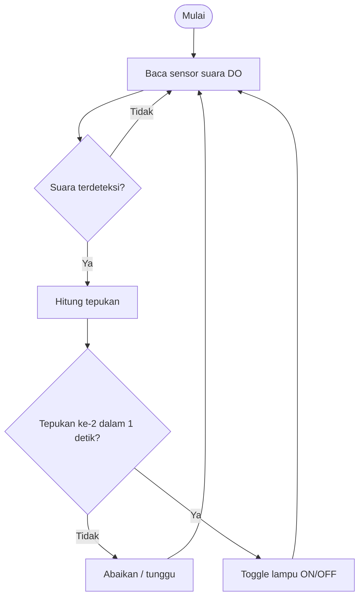

# Perancangan Sistem Smart Lamp Berbasis ESP32 Menggunakan Sensor Suara

Proyek tugas IoT: lampu pintar yang dikendalikan dengan **tepukan tangan dua kali (double clap)** menggunakan ESP32 dan sensor suara. Seluruh sistem disimulasikan di [Wokwi](https://wokwi.com).

> 🔗 **Link simulasi Wokwi:** _(tempel link proyek Wokwi kalian di sini)_

## 1. Latar Belakang & Tujuan
Saklar konvensional mengharuskan pengguna menyentuh perangkat secara fisik. Sistem ini memungkinkan lampu dinyalakan/dimatikan hanya dengan suara tepukan, sehingga lebih praktis, khususnya bagi lansia dan penyandang disabilitas.

**Tujuan:** merancang dan mensimulasikan sistem smart lamp berbasis ESP32 yang merespons sensor suara.

## 2. Komponen
| Komponen | Jumlah | Fungsi |
|---|---|---|
| ESP32 DevKit C | 1 | Mikrokontroler utama |
| Sound Sensor (KY-038) | 1 | Mendeteksi suara tepukan |
| LED kuning | 1 | Representasi lampu |
| LED hijau | 1 | Indikator tepukan terdeteksi |
| Resistor 220 Ω | 2 | Pembatas arus LED |
| Push button biru | 1 | Saklar manual (cadangan) |
| Push button merah | 1 | Simulasi tepukan tangan di Wokwi |

## 3. Wiring
| Komponen | Pin komponen | Pin ESP32 |
|---|---|---|
| Sound sensor | VCC | 3V3 |
| Sound sensor | GND | GND |
| Sound sensor | AO | GPIO 34 |
| Sound sensor | DO | GPIO 27 |
| LED lampu | Anoda (via R 220 Ω) | GPIO 26 |
| LED status | Anoda (via R 220 Ω) | GPIO 25 |
| Push button biru | Kaki 1 / kaki 2 | GPIO 14 / GND |
| Push button merah (CLAP) | Kaki 1 / kaki 2 | GPIO 13 / GND |
| Kedua LED | Katoda | GND |

## 4. Cara Kerja

1. Sensor suara menghasilkan sinyal pada pin DO saat ada suara keras.
2. ESP32 mendeteksi tepi sinyal dan menghitung jumlah tepukan.
3. Jika dua tepukan terjadi dalam **1 detik**, status lampu di-*toggle*.
4. Satu tepukan saja diabaikan untuk mengurangi pemicu palsu.
5. Tombol manual tersedia sebagai cadangan.

## 5. Cara Menjalankan Simulasi
1. Buka [wokwi.com](https://wokwi.com) → **New Project** → **ESP32**.
2. Salin isi `sketch.ino` dan `diagram.json` dari repo ini ke tab yang sesuai.
3. Klik **Start Simulation**.
4. Buka **Serial Monitor**, lalu klik tombol merah **CLAP** dua kali berturut-turut dengan cepat (kurang dari 1 detik) untuk mensimulasikan dua tepukan.
5. LED kuning akan menyala/mati, dan log tampil di Serial Monitor.

## 6. Contoh Output Serial Monitor
```
=== Smart Lamp ESP32 - Sensor Suara ===
Tepuk 2x untuk menyalakan/mematikan lampu.
[SUARA] Tepukan 1 | level analog = 2048
[SUARA] Tepukan 2 | selang = 380 ms
[LAMPU] ON   (sumber: double clap)
```

## 7. Struktur Repository
```
smart-lamp-esp32/
├── sketch.ino      # program utama
├── diagram.json    # rangkaian Wokwi
├── libraries.txt   # dependensi (kosong)
└── README.md
```

## 8. Pengembangan Lanjutan
- Mengganti LED dengan modul relay untuk lampu AC sungguhan.
- Integrasi WiFi/MQTT agar bisa dikontrol dari smartphone.
- Penambahan sensor cahaya (LDR) agar hanya aktif saat gelap.

## 9. Anggota Kelompok
| No | Nama | NIM |
|:---:|---|---|
| 1 | Agief Vemas A | G1A024037 |
| 2 | Dwi Juliani | G1A024084 |
| 3 | Adiva Luthfiyyah Yulian | G1A024110 |
